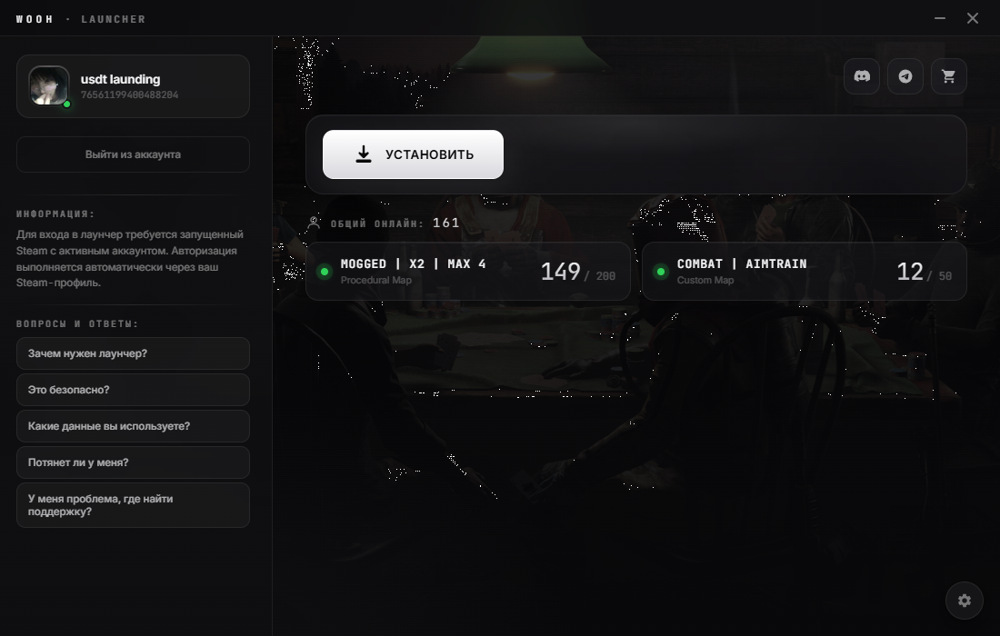

# WoohProject Launcher — исходный код

Полностью читаемый и собираемый исходник лаунчера **WoohProject Launcher 1.2.5**
(Electron 35, Windows x64). Код получен из `resources/app.asar`, деобфусцирован,
переименован, прокомментирован и проверен запуском/тестами.



## Что это

Лаунчер для игрового клиента WoohRust (Rust). Умеет:

- авторизовывать через локальный Steam (без ввода пароля);
- проверять целостность файлов игры по манифесту (размер + SHA-256);
- докачивать/обновлять клиент с нескольких HTTP-зеркал, с возобновлением,
  докачкой кусками и переключением источника;
- запускать `RustClient.exe` обычным способом или с повышением прав;
- следить за запуском и объяснять причину, если игра не открылась
  (Steam, Visual C++, антивирус, Smart App Control, повреждённые файлы);
- диагностировать сеть (system/direct/node + DoH), чинить совместимость с
  zapret/DPI-bypass;
- собирать локальные отчёты об ошибках (с очисткой путей и URL) и отправлять
  их в поддержку.

## Требования

- Windows 10/11 x64 (лаунчер использует Win32 API: registry, tasklist, PowerShell);
- Node.js 18+ и npm;
- установленный Steam — для входа в лаунчер.

## Быстрый старт

```powershell
npm install
npm start
```

Если Electron не скачался автоматически (например, из-за политики npm
`allowScripts`), выполните:

```powershell
node node_modules/electron/install.js
```

> Рекомендуется Node.js 20/22 LTS. На самых новых версиях `extract-zip` из
> состава Electron может завершиться, не распаковав бинарник. Тогда распакуйте
> закэшированный архив вручную:
>
> ```powershell
> $zip = Get-ChildItem "$env:LOCALAPPDATA\electron\Cache" -Recurse -Filter "electron-v35.7.5-win32-x64.zip" | Select-Object -First 1
> Expand-Archive $zip.FullName node_modules\electron\dist -Force
> Set-Content node_modules\electron\path.txt "electron.exe" -NoNewline
> ```

> В некоторых окружениях задан `ELECTRON_RUN_AS_NODE=1` — с ним `electron.exe`
> работает как обычный Node и приложение не запускается. Уберите переменную:
> `Remove-Item Env:ELECTRON_RUN_AS_NODE`.

## Сборка

```powershell
npm run pack          # распакованное приложение в ../artifacts/win-unpacked
npm run dist          # NSIS-установщик в ../artifacts/
npm run dist:portable # portable .exe в ../artifacts/
```

Сборка намеренно пишется **вне** папки проекта (`../artifacts`), чтобы бинарники
и установщики не попадали в исходники.

Конфигурация electron-builder находится в `package.json` (секция `build`):
appId `com.woohproject.launcher`, NSIS, иконка `src/main/icon.ico`,
`steamworks.js` распаковывается из asar (нативная N-API библиотека).

## Тесты и проверки

```powershell
npm test        # 21 тест
npm run lint    # ESLint (no-undef / no-unused-vars / …)
npm run verify  # lint + тесты
```

Покрыто:

- проверка целостности (quick/full/smart) и кэш проверенных файлов;
- запрет path traversal в путях манифеста;
- загрузчик: параллельная загрузка, Range-возобновление, куски, 404,
  pause/resume;
- манифест и пайплайн `verify → download → verify`;
- fallback на кэшированный манифест при недоступном CDN;
- сетевой доктор (классификация ошибок, sustained-probe);
- помощник (классификация, коды запуска, нехватка места);
- zapret (дописывание доменов, определение установки);
- отчёты об ошибках (очистка URL/путей, файлы отчётов);
- preload API;
- рендерер в jsdom: загрузка, авторизация, серверные счётчики, прогресс.

## Структура

```
wooh-launcher/
├─ package.json              # зависимости, скрипты, electron-builder
├─ src/
│  ├─ main/                  # главный процесс Electron
│  │  ├─ main.js             # точка входа, окно, IPC, установка, запуск
│  │  ├─ preload.js          # contextBridge → window.electronAPI
│  │  ├─ config.json         # Steam App ID, серверы, CDN, поддержка
│  │  ├─ steam-service.js    # Steam: реестр, loginusers.vdf, профиль, тикет
│  │  ├─ downloader.js       # многопоточный загрузчик с Range/кусками
│  │  ├─ game-update.js      # манифест, проверка, скачивание
│  │  ├─ integrity.js        # SHA-256, quick/smart-проверки
│  │  ├─ launcher-update.js  # самообновление лаунчера
│  │  ├─ net-transport.js    # system/direct/node + DoH, сохранение настроек
│  │  ├─ net-doctor.js       # подбор рабочего транспорта, причины сбоев
│  │  ├─ game-watch.js       # наблюдение за процессом, логи, Event Log, AV
│  │  ├─ helper.js           # «Помощник»: классификация и авто-исправления
│  │  ├─ zapret-fix.js       # добавление доменов в исключения zapret
│  │  ├─ bug-report.js       # логи, отчёты, очистка персональных данных
│  │  └─ icon.ico
│  └─ renderer/
│     ├─ index.html          # разметка (CSP)
│     ├─ styles.css          # стили
│     ├─ app.js              # вся логика UI
│     ├─ i18n.js             # русский/английский
│     └─ background.png      # фон
├─ test/run-tests.js         # тесты (мок Electron + jsdom)
├─ docs/                     # методика деобфускации и аудит безопасности
├─ AGENTS.md                 # правила для ИИ-агентов и контрибьюторов
├─ eslint.config.mjs
└─ LICENSE
```

## Как это работает

### Старт

1. `bug-report.init()` подменяет `console.*` и пишет всё в
   `%APPDATA%/wooh-launcher/logs/launcher.log`.
2. Отключаются HTTP/2 и QUIC (через часть DPI/VPN они ломаются).
3. Проверяется single-instance lock.
4. `app.whenReady()`: чистится временная папка обновления, инициализируется
   сетевой транспорт, создаётся окно 1100×700 без рамки.
5. Рендерер проходит гейты: обновление лаунчера → проверка Steam → проверка
   файлов игры → автоавторизация → серверные счётчики.

### Установка/обновление

```
verifyGame()
  ├─ fetchGameManifest()  → первый рабочий mirror отдаёт /manifest.json
  ├─ smart  → smartCheckIntegrity (доверяет кэшу, хэширует .exe/.dll)
  ├─ fast   → quickCheckIntegrity (размер)
  └─ deep   → checkIntegrity (полный SHA-256)
        ↓ filesToDownload
createGameDownloader().downloadAll()
  ├─ N воркеров, очередь «большие → маленькие»
  ├─ каждый файл: все зеркала × 2 попытки
  ├─ Range-возобновление, при обрывах — куски по 16 МБ (до 2 МБ)
  ├─ занятый файл → chmod + переименование в `.wooh-old-*`
  └─ прогресс: байты, скорость, ETA, источник
        ↓
verifyDownloadedFiles()  → SHA-256 всех скачанных
        ↓
manifest cache + verified cache
```

Ошибка на любом шаге классифицируется в `helper.tryFix()`: сеть, диск, права,
занятый файл, антивирус, целостность. Пользователю показывается диалог с
действием (повторить, закрыть игру, выбрать папку, исправить zapret), а в
`reports/` пишется отчёт.

### Запуск игры

`launchGameImpl()` проверяет `RustClient.exe` и `RustClient_Data`, затем:

- обычный режим — `spawn` с `__COMPAT_LAYER=RunAsInvoker`, чтобы игра не
  унаследовала права лаунчера;
- при ошибке `740`/блокировке — `cmd /c start` (UAC), либо диагностический
  запуск через PowerShell `ProcessStartInfo` для получения настоящего кода
  Win32 (Smart App Control, политика, антивирус).

После запуска `game-watch` 90 секунд следит за процессом, окном, `Player.log`,
краш-дампами, Event Log и антивирусами. Если игра не открылась — рендерер
получает `game-launch-issue` с причиной и предложением (починить файлы,
запустить с правами, скачать VC++).

### Сеть

`net-transport` хранит режим в `%APPDATA%/wooh-launcher/network.json`:

- `system` — Chromium как есть (прокси/VPN системы);
- `direct` — отдельная сессия Chromium в обход системного прокси;
- `node` — встроенный `fetch` Node (undici).

`net-doctor` перебирает режимы и DoH, проверяя и манифест, и sustained-загрузку
6 МБ (чтобы отсеять зеркала, которые отдают заголовки, но рвут тело).

### Steam

- `HKCU\Software\Valve\Steam\ActiveProcess` → PID и ActiveUser;
- `tasklist` → запущен ли Steam;
- `config/loginusers.vdf` → профиль и SteamID64;
- публичный XML-профиль → имя и аватар;
- `steamworks.js` → Web API ticket (кэш 45 с). Тикет никуда не отправляется —
  это задел для серверной авторизации.

## `config.json`

```jsonc
{
  "steamAuth": { "appId": "480" },          // App ID для Steam-тикета
  "servers": { "main": 11252685, "combat": 11487742 }, // id для API
  "serverQuery": {                          // прямые A2S-адреса (host:port)
    "11252685": "5.42.211.95:35001",
    "11487742": "5.42.211.95:35011"
  },
  "launcherUpdate": {
    "enabled": true,
    "manifestUrl": "/launcher/manifest.json",
    "downloadPath": "/launcher",
    "downloadConcurrency": 4,
    "mirrors": [ { "name": "Лаунчер #1", "url": "https://…" } ]
  },
  "support": { "telegram": "…", "discord": "…" },
  "gameCdn": {
    "manifestPath": "/manifest.json",
    "downloadConcurrency": 6,
    "mirrors": [ { "name": "HF #1", "url": "https://…" } ]
  }
}
```

`gameCdn.mirrors` — базы, на которых лежат `manifest.json` и файлы
(`<url>/<path>`). Манифест: `{ "files": [{ "path", "size", "sha256" }] }`.

Манифест лаунчера: `{ "version", "file", "size", "sha256" }`; установщик
запускается с `/S --force-run`.

## Хранилища данных

| Путь | Назначение |
| --- | --- |
| `%APPDATA%/wooh-launcher/logs/launcher.log` | лог (ротация при > 2 МБ) |
| `%APPDATA%/wooh-launcher/reports/` | JSON-отчёты (макс. 60) |
| `%APPDATA%/wooh-launcher/manifests/` | кэш манифеста и проверенных файлов |
| `%APPDATA%/wooh-launcher/network.json` | выбранный транспорт и DoH |
| `%APPDATA%/WoohProject/launcher-update/` | временная папка установщика |

В отчётах домашний путь заменяется на `%USERPROFILE%`, а все URL — на
`[сервер]`.

## Безопасность

- `contextIsolation: true`, `nodeIntegration: false`, узкий preload API;
- CSP в `index.html` (`script-src 'self'`, без `unsafe-eval`);
- внешние ссылки открываются в системном браузере, навигация внутри окна
  запрещена;
- пароли Steam не читаются и не запрашиваются; используется только локальный
  клиент и публичный профиль;
- отчёты очищаются от путей и адресов CDN;
- загрузки проверяются по SHA-256 из манифеста;
- пути из манифеста не могут выйти за пределы папки игры;
- `contextIsolation`, CSP и запрет навигации/внешних скриптов в окне.

Подробнее: [docs/security.md](docs/security.md).

## Что было сделано при деобфускации

- `app.asar` распакован, код переформатирован (Prettier) и очищен от
  механической обфускации: `obj["prop"]` → `obj.prop`, `!![]` → `true`,
  hex-числа → десятичные, `\x20`-escape → обычные символы, развёрнуты
  sequence expressions;
- все односимвольные имена (`a`, `b`, `c`…) заменены на смысловые, модули
  разложены по ответственности, добавлены JSDoc и комментарии;
- сохранено поведение и все пользовательские строки/иконки/стили;
- исправлены пути после переноса в `src/` (renderer, background.png);
- добавлены `package.json` с electron-builder, 21 тест, ESLint, README, CSP;
- проверено: `npm run verify`, запуск в Electron 35.7.5 (скриншот совпадает с
  оригиналом), сборка `npm run pack` и `npm run dist`.

Подробный разбор — [docs/deobfuscation.md](docs/deobfuscation.md).

## Ограничения

- Игровой клиент и CDN-контент не входят в репозиторий; без доступных
  `gameCdn.mirrors` установка невозможна.
- Самообновление лаунчера требует опубликованного `launcher/manifest.json` и
  установщика; в dev-режиме (`app.isPackaged === false`) пропускается.
- Часть проверок (Steam, антивирус, Event Log) работает только на Windows.
- Шрифты Inter/JetBrains Mono подгружаются с Google Fonts; без интернета
  используется системный fallback.
- Собранный установщик не подписан (как и оригинал) — для релиза нужен
  сертификат подписи кода, иначе SmartScreen будет предупреждать.

## Для разработчиков и ИИ-агентов

- 🧭 [AGENTS.md](AGENTS.md) — структура, команды, стиль кода, инварианты
  безопасности и подводные камни;
- 🧩 [docs/deobfuscation.md](docs/deobfuscation.md) — что было изменено при
  деобфускации и как проверялась эквивалентность;
- 🔐 [docs/security.md](docs/security.md) — аудит безопасности.

## Лицензия

MIT — см. [LICENSE](LICENSE).
