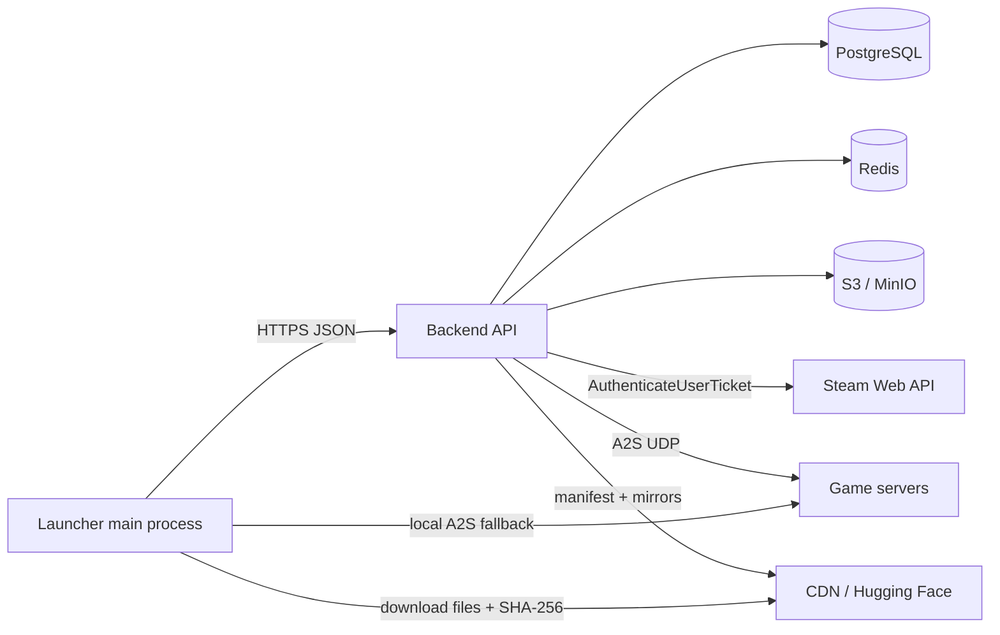
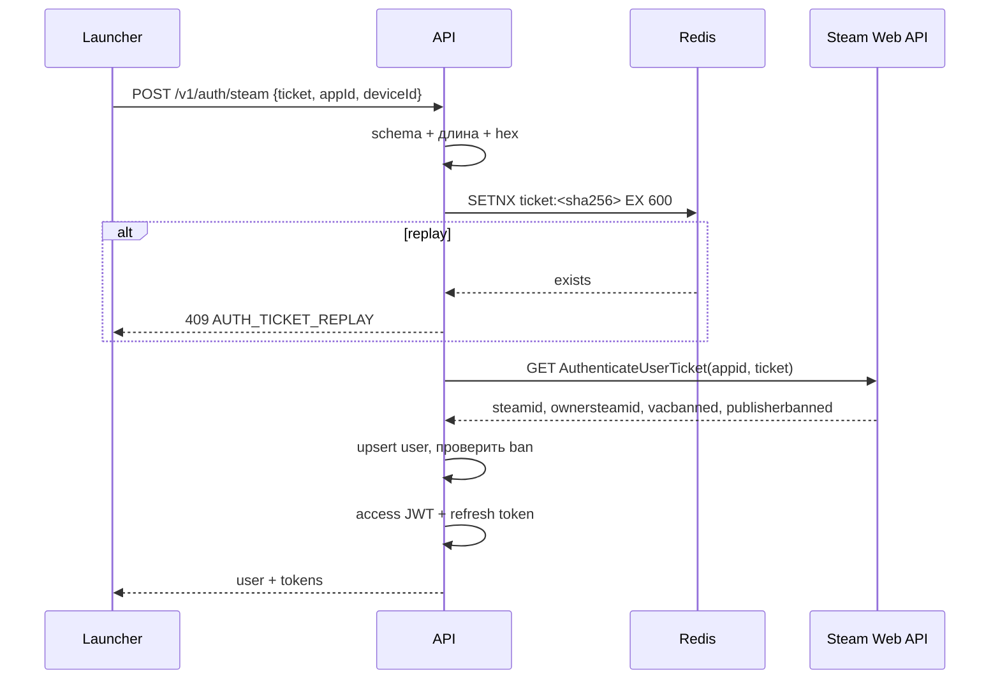

# Бекенд (API) для WoohProject Launcher

Статус: **проектная документация**. Кода бекенда в проекте пока нет; этот файл
описывает контракт, схему данных, безопасность и порядок реализации, чтобы
агент-разработчик мог добавить `server/` и подключить его к лаунчеру без
переписывания клиента.

## 1. Зачем нужен бекенд

Сейчас лаунчер работает автономно: Steam-профиль читается локально, манифест
игры и обновления лаунчера лежат на статических зеркалах, отчёты об ошибках
остаются на диске, а онлайн серверов запрашивается напрямую по A2S.

Бекенд должен убрать из клиента изменяемые и секретные данные и дать одну
точку управления:

| Сейчас | С бекендом |
| --- | --- |
| Steam-тикет получается, но никуда не отправляется | обмен тикета на сессию лаунчера (JWT) |
| `config.json` с CDN/App ID/ссылками | remote config с ETag и fallback на локальный файл |
| `launcher/manifest.json` на зеркалах | API-манифест обновления + подпись |
| `gameCdn.mirrors` + статический `manifest.json` | API-манифест игры, каналы, история версий |
| онлайн серверов напрямую (A2S / gamemonitoring) | агрегированный `/v1/servers/status` с кэшем |
| отчёты только локально | загрузка отчёта в API (опционально) |
| новости/FAQ в `i18n.js` | `/v1/news` (опционально) |

Бекенд **не**:

- хранит пароли Steam (их нет и в клиенте);
- проксирует гигабайты игры (файлы остаются на CDN);
- выполняет DRM/защиту клиента;
- собирает телеметрию без явного согласия.

## 2. Архитектура



Компоненты:

- **API** — Fastify-приложение, JSON, `/v1`, JWT, rate limit.
- **PostgreSQL** — пользователи, refresh-токены, релизы, манифесты, отчёты.
- **Redis** — кэш config/manifest, анти-replay тикетов, rate limit
  (в dev допускается in-memory fallback).
- **S3/MinIO** — установщики и, при необходимости, вложения отчётов.
- **Steam Web API** — единственный источник истины для SteamID.

## 3. Рекомендуемый стек

| Слой | Выбор | Причина |
| --- | --- | --- |
| Runtime | Node.js 22 LTS | совпадает с экосистемой проекта |
| HTTP | Fastify 5 | быстрый, JSON Schema, `app.inject()` для тестов |
| БД | PostgreSQL 16 | транзакции, `jsonb`, надёжность |
| Кэш | Redis 7 | ETag-кэш, replay-cache, rate limit |
| Файлы | S3-совместимое хранилище | установщики не должны лежать в БД |
| Тесты | `node:test` + `app.inject()` | без отдельного сервера и браузера |
| Деплой | Docker Compose + Caddy/Nginx | воспроизводимо |

Сервер живёт в отдельном пакете `server/` со своим `package.json`. Это не
попадает в Electron-сборку: `build.files` включает только `src/**/*`,
`package.json` и `LICENSE`.

## 4. Структура `server/`

```
server/
├─ package.json
├─ .env.example
├─ Dockerfile
├─ docker-compose.yml
├─ openapi.yaml              # контракт, писать до реализации
├─ migrations/
│  └─ 001_init.sql
├─ src/
│  ├─ index.js               # listen + graceful shutdown
│  ├─ app.js                 # buildApp(): плагины и роуты
│  ├─ config.js              # валидация env
│  ├─ db.js                  # pg Pool
│  ├─ migrate.js             # применение SQL-миграций
│  ├─ plugins/
│  │  ├─ errors.js           # единый формат ошибок + requestId
│  │  ├─ auth.js             # JWT, роли, admin-token
│  │  └─ cache.js            # ETag/Redis
│  ├─ routes/
│  │  ├─ health.js
│  │  ├─ config.js
│  │  ├─ auth.js
│  │  ├─ manifests.js
│  │  ├─ servers.js
│  │  ├─ reports.js
│  │  ├─ news.js
│  │  └─ admin.js
│  ├─ services/
│  │  ├─ steam.js            # AuthenticateUserTicket
│  │  ├─ tokens.js           # access/refresh, ротация
│  │  ├─ manifests.js        # выбор активного релиза/манифеста
│  │  ├─ servers.js          # A2S + gamemonitoring + кэш
│  │  └─ reports.js          # scrub, лимиты, хранение
│  └─ lib/
│     ├─ errors.js
│     ├─ crypto.js           # sha256, timingSafeEqual, random
│     └─ scrub.js            # URL/пути/PII
└─ test/
   ├─ auth.test.js
   ├─ manifests.test.js
   ├─ reports.test.js
   └─ servers.test.js
```

## 5. Конвенции API

- База: `https://api.example.com/v1` (домен задаётся в `config.json`).
- Формат: JSON UTF-8; поля `camelCase`; время — ISO 8601 UTC.
- Идентификаторы: UUIDv7 (или ULID).
- Успех: ресурс напрямую; списки — `{ "items": [], "nextCursor": null }`.
- Ошибка:

```json
{
  "error": {
    "code": "AUTH_TICKET_INVALID",
    "message": "Steam ticket is invalid",
    "details": {},
    "requestId": "01J..."
  }
}
```

- Заголовки:
  - `X-Request-Id` — принимается или генерируется, возвращается всегда;
  - `X-Api-Version: 1`;
  - `ETag` / `If-None-Match` → `304` для config и манифестов;
  - `Cache-Control`, `Retry-After` (для `429`/`503`);
  - `Idempotency-Key` для `POST /v1/reports`.
- Версионирование: только `/v1`; ломающие изменения — `/v2`; новые поля
  добавляются без смены версии и игнорируются старым клиентом.
- Лимит тела: 64 КБ для обычных JSON, 512 КБ для отчётов, 5 МБ для манифеста
  игры (admin).
- Все запросы лаунчера идут из **main process**; CORS не нужен, кроме
  отдельной админ-панели.

## 6. Аутентификация через Steam

### 6.1 Поток



### 6.2 `POST /v1/auth/steam`

Запрос:

```json
{
  "ticket": "a1b2c3...",
  "appId": 480,
  "deviceId": "9f0c2c1e-...",
  "launcherVersion": "1.2.5",
  "platform": "win-x64"
}
```

Правила:

1. `ticket` — hex, 32…4096 символов; `appId` — целое, должен совпадать с
   `STEAM_APP_ID` (480), иначе `422`.
2. `sha256(ticket)` кладётся в Redis на 10 минут (`SET NX EX 600`). Повтор —
   `409 AUTH_TICKET_REPLAY`. Если Redis недоступен, используется in-memory
   LRU с TTL (деградация, не отказ).
3. Запрос к Steam:

```
GET https://api.steampowered.com/ISteamUserAuth/AuthenticateUserTicket/v1/
  ?key=<STEAM_WEB_API_KEY>&appid=480&ticket=<ticket>
```

4. Успех — `response.params.result === "OK"`, `steamid` — 17 цифр.
   Ошибка Steam (`response.error` или `result !== "OK"`) → `401
   AUTH_TICKET_INVALID`; недоступность Steam → `503 STEAM_UNAVAILABLE`.
5. `vacbanned === true` или `publisherbanned === true` → `403 AUTH_BANNED`.
6. Пользователь upsert по `steam_id64`; `last_login_at = now()`.
7. Выдаются access JWT (15 минут) и refresh token (30 дней).

Ответ `200` (заголовок `Cache-Control: no-store`):

```json
{
  "user": {
    "id": "0192f0c2-...",
    "steamId": "76561198000000000",
    "personaName": null,
    "avatarUrl": null,
    "role": "user"
  },
  "accessToken": "eyJ...",
  "accessTokenExpiresAt": "2026-10-24T17:15:00Z",
  "refreshToken": "rt_...",
  "refreshTokenExpiresAt": "2026-11-23T17:00:00Z"
}
```

`personaName`/`avatarUrl` — косметика. Их можно заполнять фоновым
`GetPlayerSummaries`, но доверять нужно только `steamId`.

### 6.3 `POST /v1/auth/refresh`

```json
{ "refreshToken": "rt_..." }
```

- Хранится только `sha256(refreshToken)`; в БД — `family_id`, `device_id`,
  `expires_at`, `revoked_at`, `replaced_by`.
- При использовании токен ротируется: старый помечается `revoked_at`, новый
  выдаётся в той же `family_id`.
- Повторное использование уже ротированного токена → отозвать всю family,
  вернуть `401 AUTH_REFRESH_REUSED`.
- Истёкший/неизвестный токен → `401 AUTH_REFRESH_INVALID`.

Ответ — как у `/auth/steam`, без `user` (или с `user`, если удобно клиенту).

### 6.4 `POST /v1/auth/logout`

Тело `{ "refreshToken": "rt_..." }` или Bearer access token. Отзывает текущую
family. Ответ `204`.

### 6.5 `GET /v1/auth/me`

`Authorization: Bearer <access>`. Ответ:

```json
{
  "user": {
    "id": "...",
    "steamId": "...",
    "role": "user",
    "isBanned": false
  },
  "entitlements": [],
  "serverTime": "2026-10-24T17:00:00Z"
}
```

### 6.6 JWT

```json
{
  "sub": "user-uuid",
  "iss": "wooh-api",
  "aud": "wooh-launcher",
  "iat": 1761325200,
  "exp": 1761326100,
  "jti": "uuid",
  "steamId": "76561198000000000",
  "role": "user"
}
```

- HS256 (`JWT_SECRET` ≥ 32 байта) для MVP; RS256/EdDSA — при нескольких
  сервисах.
- Проверять `iss`, `aud`, `exp` с допуском 60 секунд.
- Access-токен не отзывается поштучно; при бане проверять `is_banned` в
  `/auth/me` и на защищённых роутах (кэш 60 секунд).

## 7. Remote config

### `GET /v1/config?launcherVersion=1.2.5&platform=win-x64`

Публичный, `ETag`, `Cache-Control: public, max-age=60,
stale-while-revalidate=300`.

```json
{
  "apiVersion": 1,
  "serverTime": "2026-10-24T17:00:00Z",
  "maintenance": {
    "active": false,
    "message": null,
    "until": null
  },
  "launcher": {
    "minVersion": "1.2.5",
    "latestVersion": "1.3.0"
  },
  "game": {
    "defaultChannel": "stable",
    "channels": ["stable", "beta"]
  },
  "features": {
    "serverStatus": true,
    "reports": true,
    "steamAuth": true,
    "news": false
  },
  "support": {
    "telegram": "https://t.me/...",
    "discord": "https://discord.gg/..."
  },
  "auth": {
    "required": false
  }
}
```

Правила:

- Секретов и URL с токенами в ответе быть не должно.
- Если `launcherVersion < launcher.minVersion` → клиент показывает
  принудительное обновление (`426 UPGRADE_REQUIRED` для защищённых роутов).
- `maintenance.active` блокирует установку/запуск с сообщением.
- Клиент кэширует ответ и при недоступности API использует локальный
  `config.json` — поведение не должно ухудшаться.

## 8. Обновление лаунчера

### `GET /v1/launcher/manifest?channel=stable&platform=win-x64`

Публичный, `ETag`, `Cache-Control: public, max-age=60`.

```json
{
  "channel": "stable",
  "platform": "win-x64",
  "version": "1.3.0",
  "fileName": "WoohLauncherSetup.exe",
  "size": 89842192,
  "sha256": "3120373d...",
  "url": "https://cdn.example.com/launcher/1.3.0/WoohLauncherSetup.exe",
  "mirrors": [
    "https://mirror-1.example.com/launcher/1.3.0/WoohLauncherSetup.exe"
  ],
  "mandatory": false,
  "minVersion": "1.2.0",
  "releaseNotes": "Исправлена докачка...",
  "publishedAt": "2026-10-24T12:00:00Z",
  "signature": "base64-ed25519...",
  "signatureKeyId": "launcher-2026"
}
```

- Клиент сравнивает `version` с `app.getVersion()`, проверяет `size` и
  `sha256`, затем запускает установщик с `/S --force-run` (как сейчас).
- `mandatory` и `minVersion` позволяют принудительно обновить старые версии.
- `signature` рекомендуется: Ed25519 по каноническому JSON (RFC 8785),
  публичный ключ зашит в лаунчер. Без подписи остаётся только HTTPS + SHA-256.
- `fileName` не должен содержать `/`, `\`, `..` (та же проверка, что в
  `launcher-update.js`).

## 9. Манифест игры

### `GET /v1/game/manifest?channel=stable&platform=win-x64`

Публичный, `ETag`, `Cache-Control: public, max-age=300`.

```json
{
  "channel": "stable",
  "platform": "win-x64",
  "version": "2026.10.24-1",
  "generatedAt": "2026-10-24T12:00:00Z",
  "files": [
    {
      "path": "RustClient.exe",
      "size": 123456,
      "sha256": "64-char-hex"
    }
  ],
  "mirrors": [
    { "name": "HF #1", "url": "https://huggingface.co/datasets/.../resolve/main" }
  ],
  "signature": "base64-ed25519...",
  "signatureKeyId": "game-2026"
}
```

Правила:

- `files[].path` — только относительный путь внутри папки игры; сервер
  отвергает `..`, абсолютные пути, `\` в начале, пустые сегменты.
- `size > 0`, `sha256` — 64 hex.
- Один активный манифест на `(channel, platform)`; старые хранятся для
  отката.
- Сервер может не хранить сами файлы: только манифест и список зеркал.
- Клиент уже умеет проверять `size`/`sha256` и скачивать по `<mirror>/<path>`;
  нужно добавить чтение `mirrors` из ответа API и fallback на `config.json`.

### `GET /v1/game/manifests/:version` (admin/rollback)

Возвращает конкретную версию; полезно для отката и диагностики.

## 10. Онлайн серверов

### `GET /v1/servers/status`

Публичный, кэш 10 секунд, `stale-while-revalidate=30`.

```json
{
  "updatedAt": "2026-10-24T17:00:00Z",
  "servers": [
    {
      "id": "main",
      "name": "MAIN",
      "host": "5.42.211.95",
      "port": 35001,
      "online": 149,
      "max": 200,
      "queue": 0,
      "map": "Procedural Map",
      "status": "online",
      "source": "a2s"
    },
    {
      "id": "combat",
      "name": "COMBAT",
      "host": "5.42.211.95",
      "port": 35011,
      "online": 12,
      "max": 50,
      "queue": 0,
      "map": "Custom Map",
      "status": "online",
      "source": "gamemonitoring"
    }
  ]
}
```

- Сервер опрашивает A2S по UDP (`/v1` не проксирует UDP от клиента).
- При недоступности A2S — fallback на `api.gamemonitoring.ru` (как в
  `main.js`), с пометкой `source`.
- Клиент при недоступности API делает прямой A2S-запрос, как сейчас.

## 11. Отчёты об ошибках

### `POST /v1/reports`

Аутентификация **опциональна**: отчёт должен отправляться, даже если вход
сломан. Если есть Bearer — привязать `user_id`.

Заголовки: `Content-Type: application/json`,
`Idempotency-Key: <reportId>`, допускается `Content-Encoding: gzip`.

```json
{
  "reportId": "M1ABC123",
  "area": "install-game",
  "stage": "download",
  "message": "Не удалось скачать ...",
  "stack": "Error: ...\n  at ...",
  "app": {
    "version": "1.2.5",
    "electron": "35.7.5",
    "chrome": "134...",
    "node": "22...",
    "packaged": true
  },
  "system": {
    "platform": "win32",
    "release": "10.0.26100",
    "arch": "x64",
    "locale": "ru",
    "cpus": 8,
    "totalMemGB": 16,
    "freeMemGB": 4,
    "uptimeMin": 120
  },
  "context": {
    "network": { "mode": "system", "doh": false },
    "installRunning": true,
    "helper": { "kind": "network", "autoRetry": true }
  },
  "log": ["2026-10-24T... [LOG] ..."]
}
```

Правила:

- Лимит 512 КБ; `log` — не более 400 строк.
- Сервер повторно вычищает URL, домашние пути, e-mail и токены
  (`lib/scrub.js`), даже если клиент уже это сделал.
- `reportId` уникален; повтор с тем же `Idempotency-Key` возвращает тот же
  ответ (`200`), а не создаёт дубль.
- Rate limit: 20 отчётов/час/IP, 5/час/deviceId.
- Ответ `201`:

```json
{ "id": "0192f...", "reportId": "M1ABC123", "receivedAt": "2026-10-24T17:00:00Z" }
```

- Хранение: 90 дней, затем удаление. Сырые IP не хранятся — только
  `sha256(ip + salt)`.
- Админ: `GET /v1/admin/reports?area=&status=&cursor=`, `GET
  /v1/admin/reports/:id`, `PATCH /v1/admin/reports/:id` (`status:
  new|in_progress|resolved`).
- Вложения (скриншоты) — не в MVP; при необходимости presigned upload в S3.

## 12. Новости (опционально)

### `GET /v1/news?locale=ru&limit=20`

```json
{
  "items": [
    {
      "id": "uuid",
      "title": "Вайп серверов",
      "body": "Текст...",
      "locale": "ru",
      "publishedAt": "2026-10-24T12:00:00Z",
      "pinned": false
    }
  ],
  "nextCursor": null
}
```

Позволяет убрать новости из `i18n.js`. Не входит в MVP; можно оставить
статику.

## 13. Админ-API

MVP: доступ по `Authorization: Bearer <ADMIN_TOKEN>` (переменная окружения,
сравнение `timingSafeEqual`). Позже — OIDC/SSO и роль `admin` в БД.

| Метод | Путь | Назначение |
| --- | --- | --- |
| `POST` | `/v1/admin/launcher/releases` | опубликовать релиз лаунчера |
| `GET` | `/v1/admin/launcher/releases` | список релизов |
| `POST` | `/v1/admin/launcher/releases/:id/activate` | откатить/включить версию |
| `POST` | `/v1/admin/game/manifests` | загрузить манифест игры |
| `GET` | `/v1/admin/game/manifests` | список манифестов |
| `POST` | `/v1/admin/game/manifests/:id/activate` | откат версии |
| `GET` | `/v1/admin/reports` | отчёты (пагинация, фильтры) |
| `PATCH` | `/v1/admin/reports/:id` | статус отчёта |
| `POST` | `/v1/admin/users/:id/ban` | бан/разбан |
| `GET` | `/v1/admin/audit` | аудит действий |

Пример публикации релиза:

```json
{
  "channel": "stable",
  "platform": "win-x64",
  "version": "1.3.0",
  "fileName": "WoohLauncherSetup.exe",
  "size": 89842192,
  "sha256": "3120373d...",
  "url": "https://cdn.example.com/launcher/1.3.0/WoohLauncherSetup.exe",
  "mirrors": [],
  "mandatory": false,
  "minVersion": "1.2.0",
  "releaseNotes": "Исправлена докачка"
}
```

Сервер валидирует поля, деактивирует предыдущий релиз в этом канале и пишет
`audit_log`. Для больших файлов — `POST /v1/admin/uploads/presign`
(presigned PUT в S3), затем релиз со ссылкой на объект.

## 14. Схема данных

```sql
create table users (
  id uuid primary key,
  steam_id64 text not null unique check (steam_id64 ~ '^[0-9]{17}$'),
  persona_name text,
  avatar_url text,
  role text not null default 'user' check (role in ('user', 'admin')),
  is_banned boolean not null default false,
  created_at timestamptz not null default now(),
  last_login_at timestamptz
);

create table refresh_tokens (
  id uuid primary key,
  user_id uuid not null references users(id) on delete cascade,
  family_id uuid not null,
  token_hash char(64) not null unique,
  device_id text,
  user_agent text,
  ip_hash char(64),
  created_at timestamptz not null default now(),
  expires_at timestamptz not null,
  revoked_at timestamptz,
  replaced_by uuid references refresh_tokens(id)
);
create index on refresh_tokens (user_id, family_id);

create table launcher_releases (
  id uuid primary key,
  channel text not null default 'stable',
  platform text not null default 'win-x64',
  version text not null,
  file_name text not null,
  size bigint not null check (size > 0),
  sha256 char(64) not null,
  url text not null,
  mirrors jsonb not null default '[]',
  mandatory boolean not null default false,
  min_version text,
  release_notes text,
  signature text,
  signature_key_id text,
  is_active boolean not null default true,
  published_at timestamptz not null default now(),
  created_at timestamptz not null default now(),
  unique (channel, platform, version)
);
create unique index one_active_launcher_release
  on launcher_releases (channel, platform) where is_active;

create table game_manifests (
  id uuid primary key,
  channel text not null default 'stable',
  platform text not null default 'win-x64',
  version text not null,
  files jsonb not null,
  mirrors jsonb not null default '[]',
  signature text,
  signature_key_id text,
  is_active boolean not null default true,
  created_at timestamptz not null default now(),
  unique (channel, platform, version)
);
create unique index one_active_game_manifest
  on game_manifests (channel, platform) where is_active;

create table reports (
  id uuid primary key,
  client_report_id text not null unique,
  user_id uuid references users(id) on delete set null,
  area text,
  message text,
  app_version text,
  payload jsonb not null,
  ip_hash char(64),
  status text not null default 'new'
    check (status in ('new', 'in_progress', 'resolved')),
  created_at timestamptz not null default now()
);
create index on reports (created_at desc);

create table audit_log (
  id uuid primary key,
  actor text not null,
  action text not null,
  entity text not null,
  entity_id text,
  meta jsonb not null default '{}',
  created_at timestamptz not null default now()
);
```

## 15. Переменные окружения

```ini
NODE_ENV=production
PORT=8080
PUBLIC_BASE_URL=https://api.example.com
DATABASE_URL=postgres://wooh:password@db:5432/wooh
REDIS_URL=redis://redis:6379
STEAM_WEB_API_KEY=...
STEAM_APP_ID=480
JWT_SECRET=...                 # >= 32 случайных байта
JWT_ISSUER=wooh-api
JWT_AUDIENCE=wooh-launcher
ACCESS_TOKEN_TTL_SECONDS=900
REFRESH_TOKEN_TTL_DAYS=30
ADMIN_TOKEN=...                # MVP, заменить на OIDC
IP_HASH_SALT=...
REPORT_RETENTION_DAYS=90
RATE_LIMIT_ENABLED=true
TRUST_PROXY=1
LOG_LEVEL=info
S3_ENDPOINT=...
S3_BUCKET=wooh-artifacts
S3_ACCESS_KEY=...
S3_SECRET_KEY=...
```

Секреты не коммитить; `.env` — в `.gitignore`. Для dev — `.env.example`.

## 16. Безопасность

- Steam Web API key — только на сервере.
- Steam ticket не логировать; в БД хранить только его хэш для replay-защиты.
- JWT/refresh не логировать; pino redact:
  `authorization`, `req.headers.authorization`, `ticket`, `refreshToken`.
- Refresh-токены — только в `HttpOnly`-хранилище клиента (в Electron —
  `safeStorage`, не в renderer).
- Паролей нет; админ — токен/OIDC.
- Все SQL-запросы — параметризованные.
- Валидация manifest paths: `..`, абсолютные пути, `\0`, пустые сегменты —
  отказ.
- Ограничение размера тела и глубины JSON.
- Rate limit на все публичные роуты; `429` + `Retry-After`.
- `helmet`, HSTS, `X-Content-Type-Options`, запрет `TRACE`.
- Секреты только из env; ротация `JWT_SECRET` с двумя ключами (kid).
- Аудит админ-действий.
- Не хранить сырые IP; только соль+хэш.
- Не принимать произвольные URL для скачивания (никакого SSRF): только
  зеркала из allowlist.

## 17. Подключение к лаунчеру

### 17.1 Конфиг

Добавить в `src/main/config.json`:

```json
{
  "api": {
    "enabled": false,
    "baseUrl": "https://api.example.com",
    "timeoutMs": 15000,
    "authRequired": false,
    "channel": "stable"
  }
}
```

`enabled: false` — поведение полностью как сейчас; API используется только
после включения. Это важно для поэтапного rollout и отката.

### 17.2 Новые модули

```
src/main/api-client.js     # fetchVia + JSON, X-Request-Id, retry, таймауты
src/main/auth-store.js     # safeStorage: access/refresh/deviceId
src/main/auth-service.js   # loginWithSteam, ensureSession, refresh, logout
```

`api-client` использует `transport.fetchVia` — значит, работают режимы
`system/direct/node` и DoH, уже реализованные в `net-transport.js`.

Скетч:

```js
// src/main/auth-service.js
async function loginWithSteam() {
  const ticket = await getSteamSessionTicket(config.steamAuth.appId);
  const result = await api.post("/v1/auth/steam", {
    ticket,
    appId: Number(config.steamAuth.appId),
    deviceId: store.deviceId(),
    launcherVersion: app.getVersion(),
    platform: "win-x64",
  });
  await store.saveTokens(result);
  return result.user;
}

async function ensureSession() {
  if (!config.api?.enabled) return null;
  let tokens = await store.loadTokens();
  if (!tokens) return null;
  if (Date.now() < tokens.accessExpiresAt - 60_000) return tokens;
  try {
    tokens = await api.post("/v1/auth/refresh", { refreshToken: tokens.refreshToken });
    await store.saveTokens(tokens);
    return tokens;
  } catch {
    await store.clear();
    return null;
  }
}
```

### 17.3 IPC

Добавить в preload/main:

| Канал | Назначение |
| --- | --- |
| `auth-login` | обмен Steam ticket на сессию API |
| `auth-logout` | отзыв refresh + очистка хранилища |
| `auth-state` | `{authenticated, steamId, offline}` без токенов |
| `api-config` | remote config (кэш) |
| `report-upload` | отправка отчёта в API |

Токены **никогда** не передаются в renderer. UI получает только профиль и
флаги.

### 17.4 Интеграция по модулям

| Модуль | Изменение |
| --- | --- |
| `steam-service.js` | без изменений: тикет уже получается |
| `main.js` (`steam-auth`) | после локального профиля — `authService.loginWithSteam()` (не блокируя UI) |
| `launcher-update.js` | сначала `GET /v1/launcher/manifest`, при ошибке — старые зеркала |
| `game-update.js` | сначала `GET /v1/game/manifest`, при ошибке — `config.gameCdn` |
| `main.js` (`fetch-server-data`) | сначала `GET /v1/servers/status`, при ошибке — A2S/API |
| `bug-report.js` | `POST /v1/reports` при `features.reports`, иначе локально |
| `renderer/app.js` | статус «онлайн/офлайн», maintenance/update-гейты |
| `launcher-update.js` | проверка `minVersion`/`mandatory` |

### 17.5 Офлайн-поведение

- API недоступен → лаунчер работает как сейчас (локальный Steam, зеркала,
  A2S).
- `auth.required: false` — игра запускается без сессии API.
- `auth.required: true` — без сессии показывается гейт, но только если
  `config` получен; при полном офлайне — сообщение и повтор.
- Таймауты: 3 с на connect, 15 с на запрос, 2 ретрая с jitter.
- Кэш config/manifest — в `%APPDATA%/wooh-launcher/cache/`.

### 17.6 Ошибки клиента

| HTTP | Код | Поведение |
| --- | --- | --- |
| `401` | `AUTH_*` | очистить сессию, предложить войти снова |
| `403` | `AUTH_BANNED` | показать сообщение, заблокировать онлайн-функции |
| `409` | `AUTH_TICKET_REPLAY` | получить новый тикет и повторить один раз |
| `426` | `UPGRADE_REQUIRED` | принудительное обновление лаунчера |
| `429` | `RATE_LIMITED` | `Retry-After`, exponential backoff |
| `503` | `MAINTENANCE` | сообщение, офлайн-режим |
| `5xx` | — | 2 ретрая, затем fallback |

## 18. Порядок реализации

1. **Контракт.** Создать `server/openapi.yaml` по разделам 6–13; проверить
   схемы.
2. **Каркас.** `server/package.json`, Fastify, env-валидация, `/healthz`,
   `/readyz`, единый формат ошибок, requestId, pino + redact.
3. **БД.** Миграции из раздела 14, `migrate.js`, docker-compose (Postgres,
   Redis).
4. **Steam-auth.** `services/steam.js`, `services/tokens.js`, роуты
   `/auth/*`, replay-кэш, тесты с моком Steam API.
5. **Config + launcher manifest.** ETag, кэш, админ-публикация релизов.
6. **Game manifest.** Валидация путей/хэшей, active/rollback, админ-роут.
7. **Servers.** A2S + gamemonitoring, кэш 10 с, fallback, тесты.
8. **Reports.** Приём, scrub, идемпотентность, лимиты, админ-список.
9. **Admin.** Токен, аудит, баны.
10. **Клиент.** `api-client`, `auth-store`, `auth-service`, фича-флаг
    `api.enabled=false` по умолчанию.
11. **Интеграция.** Manifest/config/servers/reports с fallback; тесты
    офлайна и `401 → refresh`.
12. **Rollout.** Включить API для сотрудников → бета → все; только после
    стабильности убирать статические зеркала.

## 19. Критерии приёмки

- `GET /healthz` — `200` без зависимостей; `/readyz` — `200` при живой БД
  (Redis опционален).
- Steam-auth: валидный тикет → `200`; невалидный → `401`; повтор → `409`;
  бан → `403`; Steam недоступен → `503`.
- Refresh: ротация, повторное использование → отзыв family и `401`.
- Config/manifest: `ETag` → `304`; неверный `If-None-Match` → `200`.
- Манифест с `../` или абсолютным путём → `422`, ничего не публикуется.
- Отчёт: идемпотентный повтор, лимит 512 КБ, `429` при спаме.
- Админ-роуты без токена → `401`, с токеном → `200`.
- Клиент с `api.enabled=false` работает как раньше; все 21 тест проходят.
- Клиент с API: при `401` делает refresh, при недоступности — fallback.
- OpenAPI-схема валидна, контрактные тесты зелёные.
- В логах нет токенов, тикетов и сырых IP.

## 20. Что не делать

- Не хранить пароли Steam и не просить их.
- Не проксировать файлы игры через API.
- Не принимать от клиента произвольные URL для скачивания.
- Не логировать `Authorization`, `ticket`, `refreshToken`.
- Не включать API по умолчанию в клиенте.
- Не ломать офлайн-режим: лаунчер должен запускаться и играть без бекенда,
  если `auth.required: false`.
- Не менять `name` пакета и путь `userData` (`%APPDATA%/wooh-launcher`).
